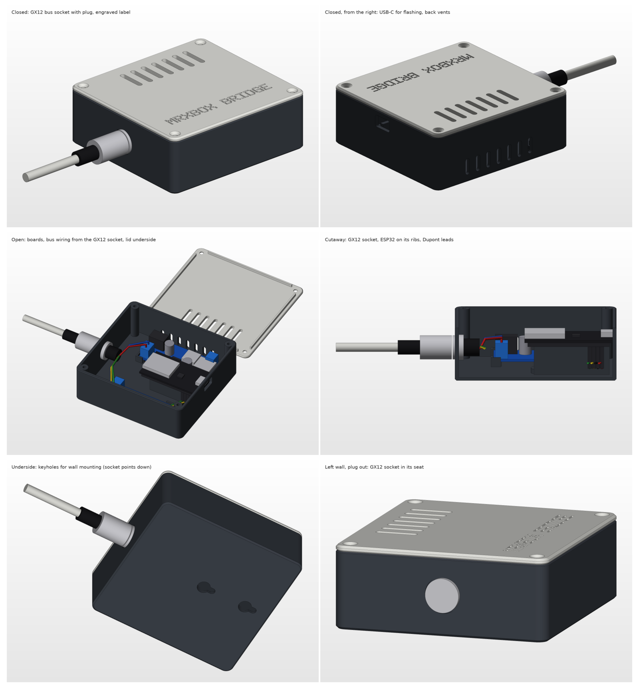

# Bridge case (ESP32 + XY-485 + HW-688 buck)

Two-part printable case for the RS485 bridge from
[karwantes/Nuaire-MVHR](https://github.com/karwantes/Nuaire-MVHR) option 1.
**Not printed or test-fitted yet.** Board and connector sizes come from seller
listings, so measure your parts before printing (see below).



| File | What |
|---|---|
| `base.stl` | Base: print open side up |
| `lid.stl` | Lid: already flipped, flat top on the bed |
| `case.py` | Generator. All dimensions are in the `PARAMETERS` block |
| `render.py` | 3D renders with rough board, connector and wiring models |
| `renders/` | Closed, open, cutaway, underside and socket views; `sheet.png` has all six |
| `preview.png` | Top-down cross-sections with the board volumes drawn in |

Outer size is 101.8 × 95.8 × 36.6 mm. The case has rounded corners and
chamfered edges, a two-tone base and lid, and an engraved label.

## Connector

The bus cable plugs into a **GX12 4-pin aviation socket** (M12 thread,
12.2 mm panel hole) on the left wall. Buy one GX12-4 pair (panel socket plus
cable plug) and use this pin order:

| GX12 pin | Bus wire | Goes to |
|---|---|---|
| 1 | red, +10 V | buck IN+ |
| 2 | yellow | XY-485 A+ |
| 3 | green | XY-485 B− |
| 4 | blue, 0 V | buck IN−, XY-485 GND, ESP32 GND |

This follows Nuaire's own colour order (red, yellow, green, blue, power on
the outer pins, data in the middle), so the lead reads the same at both ends.

## Before printing: measure and edit `case.py`

| Part | Assumed | Parameter |
|---|---|---|
| HW-688 buck | 63.4 × 27.5 mm, 14 mm tallest part | `BUCK` |
| ESP32-WROOM-32 38-pin USB-C | up to 55.5 × 28.5 mm, 3.6 mm | `ESP` |
| XY-485 | 52.0 × 23.0 mm, 11 mm | `XY485` |
| GX12 socket | 12.2 mm hole, 16.5 mm nut, 19 mm deep inside | `GX_*` |

Also check that the ESP32's USB-C socket is centred across the board width,
because the opening assumes it is.

Then rebuild. The script checks that no board, connector, Dupont lead, USB
plug or mounting-screw head hits the case or lid, and exits non-zero if
anything clashes:

```sh
python3 -m venv .venv && .venv/bin/pip install manifold3d numpy matplotlib
.venv/bin/python hardware/case/case.py --preview
.venv/bin/python hardware/case/render.py
```

## Printing

- **PETG**, not PLA. A warm airing cupboard can get close to the temperature
  where PLA starts to soften.
- 0.2 mm layers, 3 walls, 20 % infill, no supports.
- The label is engraved 0.6 mm into the lid's top, which prints face down. Use
  a clean, level bed, or set `LABEL = ""` to drop it.

## Assembly

- **GX12 socket:** fit it from outside into the round seat and tighten the nut
  inside.
- **Buck module:** DC-jack (input) end towards the socket.
- **XY-485:** A+/B- terminal end towards the socket.
- **ESP32:** sits pins-down on the two ribs, with its USB-C end against the
  right wall. Female Dupont leads fit under it. Fix it with foam tape.
- **5 V wiring:** the buck's OUT terminal goes to the ESP32 5V pin and the
  XY-485 VCC.
- **Securing boards:** the buck and XY-485 sit on corner pads inside clips.
  Add a dab of hot glue if they rattle.
- **Lid:** 4 × M3 × 10 countersunk screws into 2.5 mm pilot holes in the
  corner bosses.
- **Wall mounting:** two keyholes in the floor take 4 mm pan-head screws,
  30 mm apart. Hang the case with the socket pointing down, so the cables
  drop straight out and water can't run into them.

## Power caveats

- The HW-688 is sold as **9–36 V in**. The bus supply is about +10 V
  (upstream's measurement), which leaves little headroom. Meter the bus first.
  If the ESP32 browns out, use a buck module with a lower minimum input instead.
- Meter the buck's 5 V output before connecting anything to it.
- Disconnect the bus before plugging USB into the ESP32. After the first
  flash, use OTA updates.
